# Cyclic Rule Issue Fix (Vortex)

## What is it and why does it happen?

The collection has rules for mod load order, such as "load A after B". When the collection is updated these rules can change, but Vortex doesn't remove the old ones. You can end up with a set of rules like "load A after B", "load B after C", "load C after A", which no load order can satisfy. That is a cyclic rule issue.

Launching the game with an unresolved cyclic rule issue will crash it: the mods aren't sorted properly and their dependencies aren't met.

## How to fix it

### Part 1: Clear plugin groups

**1.** Select the **Plugins** tab in Vortex.

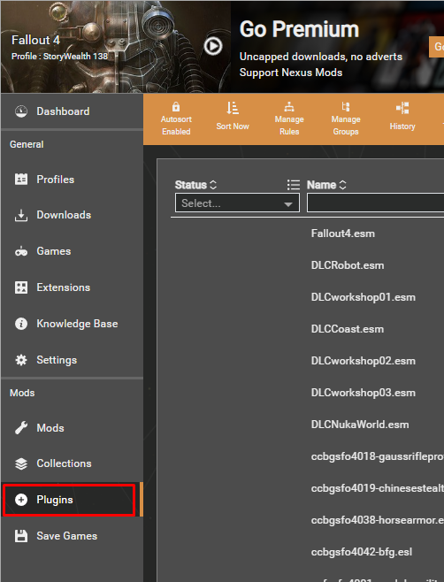

**2.** Double-click any plugin in the list so its properties panel opens on the right.

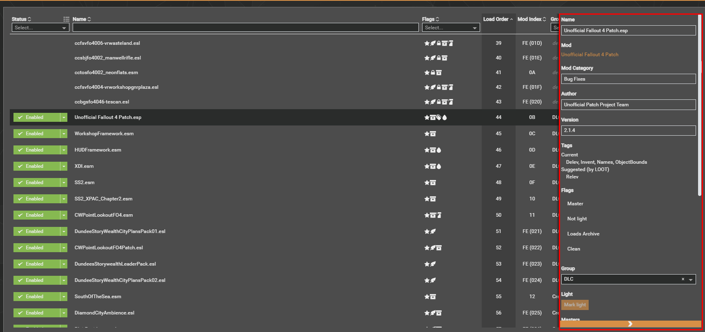

**3.** Press **Ctrl+A** to select every loaded plugin.

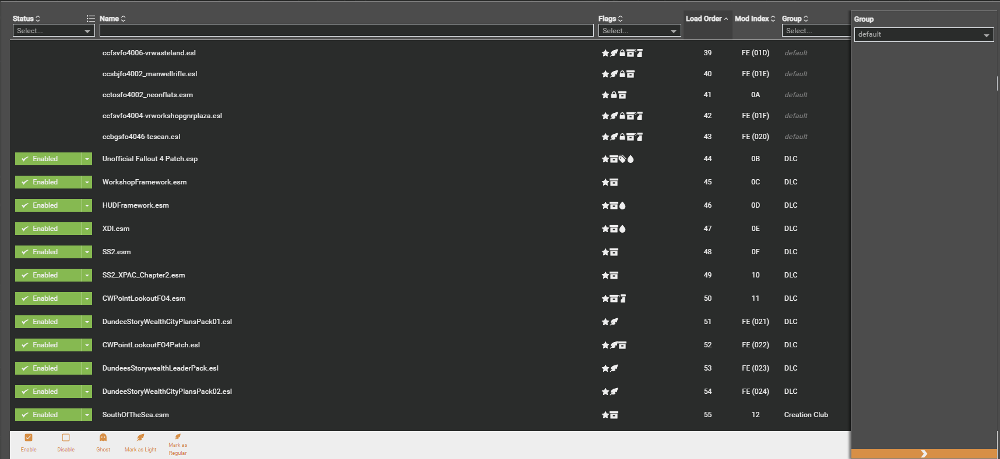

**4.** Change the group of the selected plugins to any group. "Creation Club" is used here, but any group works.

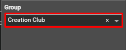

**5.** Click the **x** to remove the selected group.

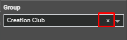

**6.** Every plugin should now show its group in grey italics.

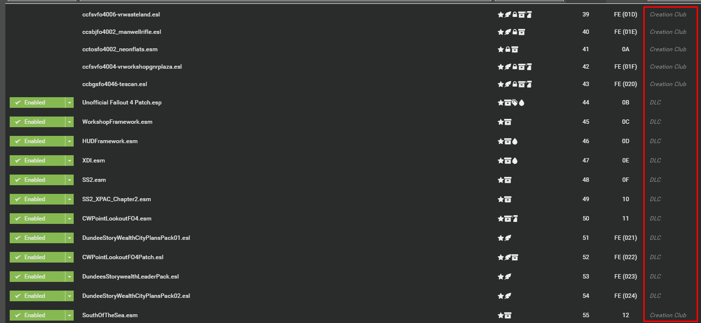

### Part 2: Re-apply the collection's rules

**7.** Go to the **Mods** tab, right-click the **A StoryWealth** collection and choose **Reinstall**.

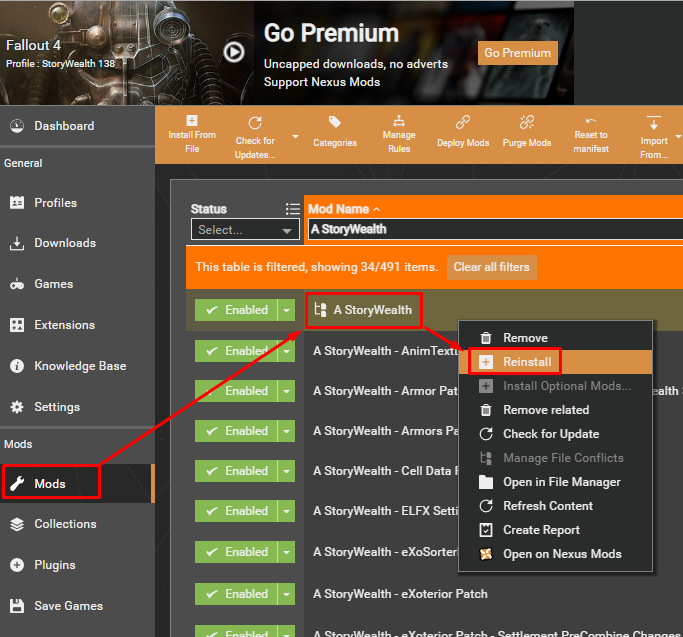

> If Reinstall gives you an "unknown download" error, use **Apply Collection Rules** from the same menu instead, then continue at step 11.
>
> 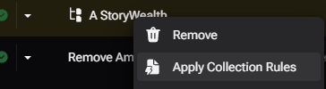

**8.** Choose **Replace the existing mod**.

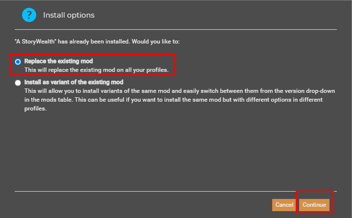

**9.** Don't disable mods, even though this window suggests it. Click **Close**.

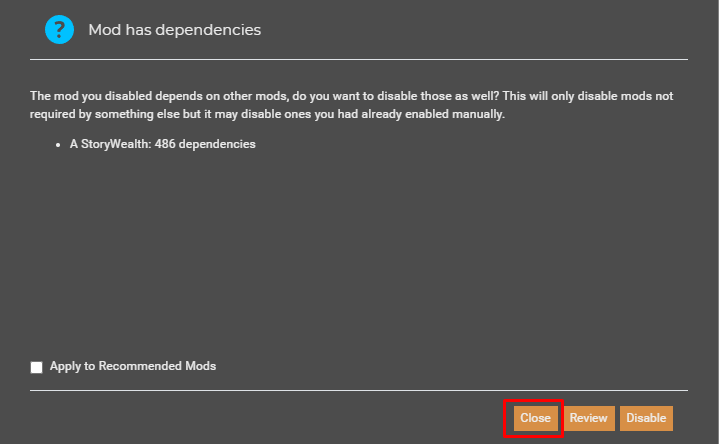

**10.** Choose **Install Now** on the current profile.

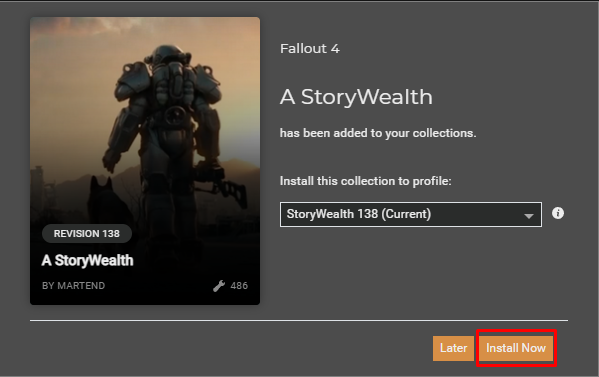

**Using a collection add-on?** Repeat steps 7 to 10 for the add-on before step 11.

**11.** When the installation has finished, click **Sort Now** in the Plugins tab.

## Still getting the error?

**Remove custom rules:** in the cyclic rule window, tick **Remove Custom Rule** and click **Apply Selected**.

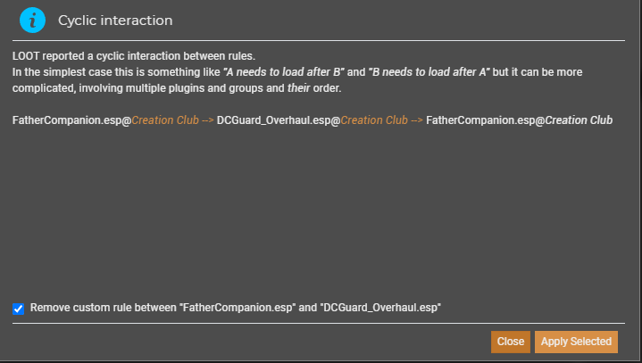

**Leftover rule lines:** if you see a line like the one below, right-click it and remove it.

