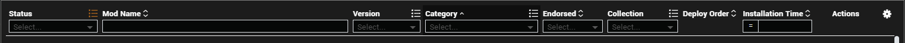
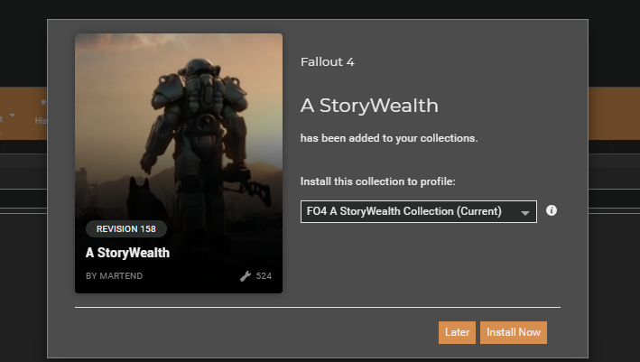

# How to Reinstall the Collection (Vortex)

This is the default way to reinstall the collection.

**1.** Make sure no filters are selected in the **Mods** tab.

**2.** Remove (uninstall) all mods. Press **Ctrl+A** to select them all, then click **Remove** at the bottom. **Don't delete the archives.**

Check that every mod is marked **Uninstalled**:

not **Disabled**:

**3.** Go to the [collection page](https://www.nexusmods.com/games/fallout4/collections/5atq9t) and add the latest revision. Overwrite or redownload if asked.

**4.** Click **Install Now** when asked.

**Using collection add-ons?** Repeat steps 3 and 4 for each add-on before step 5.

**5.** Go to the **Plugins** tab and click **Sort Now**.
